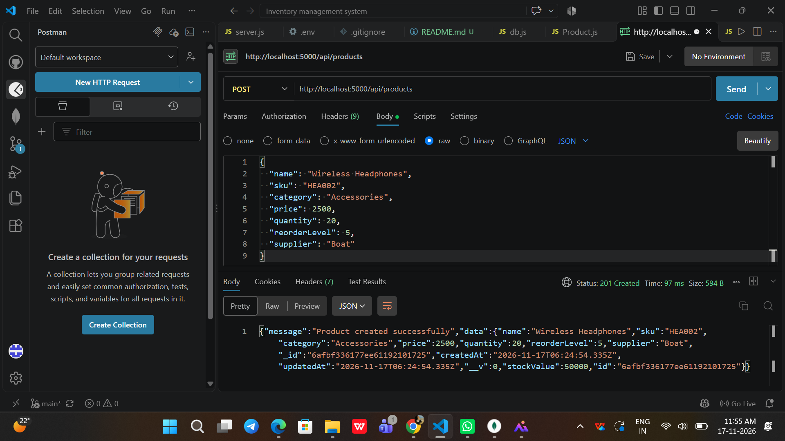
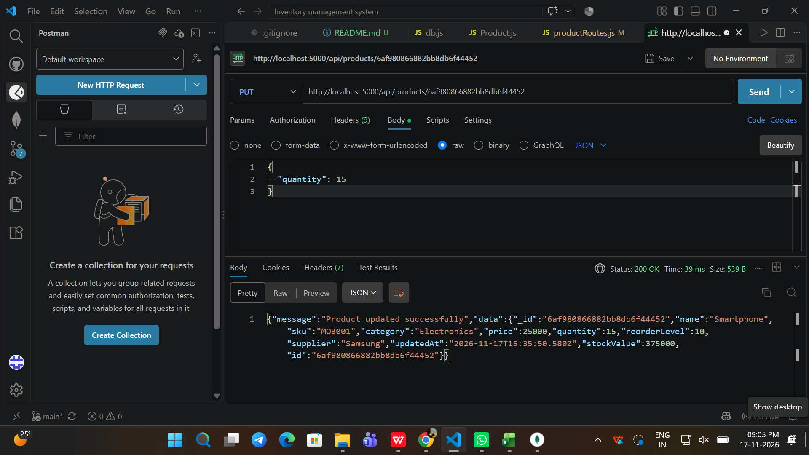
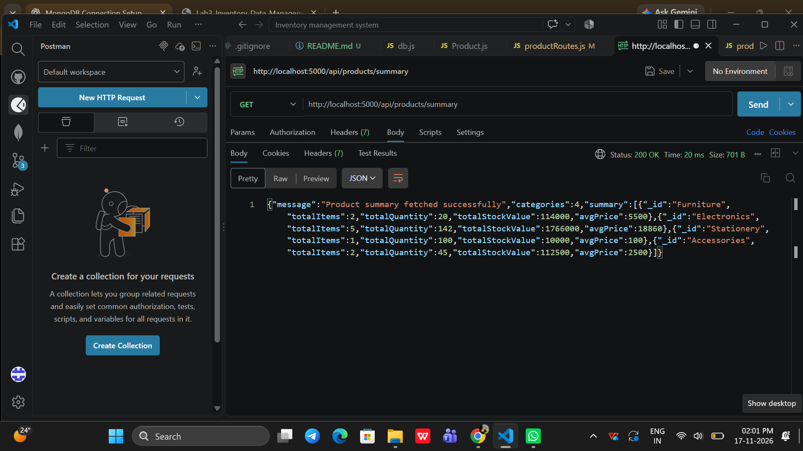
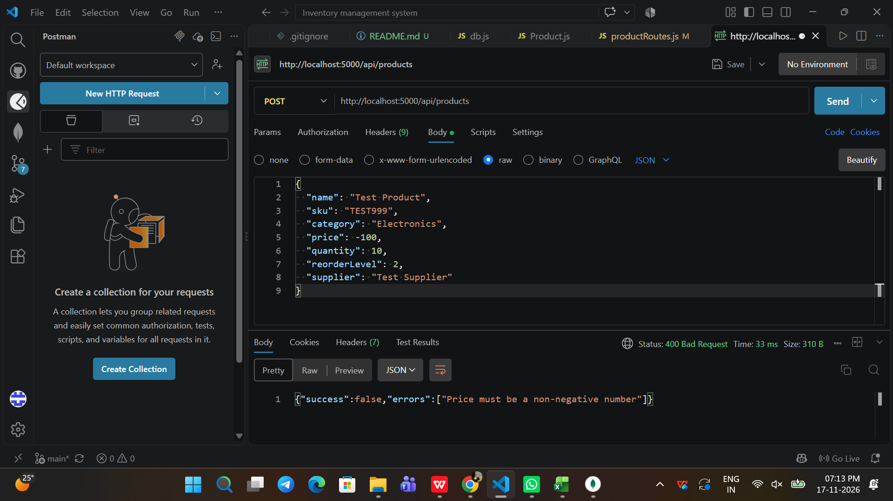

# Inventory Management System

A RESTful Inventory Management System built using Node.js, Express.js, MongoDB, and Mongoose. This project allows users to manage products, maintain inventory stock, perform CRUD operations, and generate inventory reports through REST APIs.

## Technologies Used

- Node.js
- Express.js
- MongoDB
- Mongoose
- dotenv
- Postman
- Git & GitHub

## Features

- Create, Read, Update and Delete products (CRUD)
- Unique SKU validation
- Product field-level validation
- Search products by name
- Filter products by category and price range
- Sort products by price, name, quantity, and creation date
- Pagination using page and limit
- Stock increment and decrement
- Prevention of negative stock quantity
- Low-stock alert report
- Category-wise inventory summary
- MongoDB Aggregation Pipeline
- Input validation middleware
- Invalid Product ID validation
- Centralized error-handling middleware
- Environment variable configuration using dotenv

## Project Structure

```text
Inventory Management System/
│
├── config/
│   └── db.js
│
├── controllers/
│   └── productController.js
│
├── middleware/
│   ├── validateObjectId.js
│   └── validateProduct.js
│
├── models/
│   └── Product.js
│
├── routes/
│   └── productRoutes.js
│
├── screenshots/
│   ├── post-create-product.png
│   ├── GET – All Products.png
│   ├── GET – Product by ID.png
│   ├── PUT – Update Product 1.png
│   ├── PUT – Update Product 2.png
│   ├── DELETE – Delete Product 1.png
│   ├── DELETE – Delete Product 2.png
│   ├── low stock.png
│   ├── summary.png
│   ├── Patch stock-adjustment.png
│   ├── Invalid Product ID.png
│   ├── input-validation.png
│   └── valid-product-update.png
│
├── .env
├── .gitignore
├── package.json
├── package-lock.json
└── server.js
```

## Installation and Setup

### 1. Clone the Repository

```bash
git clone https://github.com/jiyasingh0987/Inventory-Management-System.git
```

### 2. Navigate to the Project Folder

```bash
cd Inventory-Management-System
```

### 3. Install Dependencies

```bash
npm install
```

### 4. Configure Environment Variables

Create a `.env` file in the root directory.

```env
PORT=5000
MONGO_URI=your_mongodb_connection_string
```

### 5. Start the Server

```bash
npm start
```

Server runs at:

`http://localhost:5000`

## API Endpoints

Base URL: `http://localhost:5000/api/products`

| Method | Endpoint | Description |
|---|---|---|
| POST | `/` | Create a product |
| GET | `/` | Get all products |
| GET | `/:id` | Get product by ID |
| PUT | `/:id` | Update product details |
| DELETE | `/:id` | Delete a product |
| PATCH | `/:id/stock` | Adjust product stock |
| GET | `/low-stock` | Get low-stock products |
| GET | `/summary` | Get category-wise inventory summary |

## Filtering, Sorting and Pagination

The Get All Products API supports:

- `category` – Filter products by category
- `search` – Search products by name
- `minPrice` – Minimum product price
- `maxPrice` – Maximum product price
- `sort` – Sort by price, name, quantity, or createdAt
- `page` – Page number
- `limit` – Number of products per page

Example:

```text
/api/products?category=Electronics&page=1&limit=5&sort=price
```

## Stock Management

The stock adjustment API supports both stock addition and deduction.

Example request:

```json
{
  "change": 10
}
```

- Positive value increases stock.
- Negative value decreases stock.
- Negative stock quantities are not allowed.

## Inventory Reports

### Low-Stock Alert

Returns products whose available quantity is less than or equal to their reorder level.

### Category-wise Inventory Summary

Uses MongoDB Aggregation Pipeline to calculate:

- Total products per category
- Total quantity
- Total stock value
- Average product price

## Sample Product JSON

```json
{
  "name": "Laptop",
  "sku": "LAP003",
  "category": "Electronics",
  "price": 55000,
  "quantity": 15,
  "reorderLevel": 5,
  "supplier": "Dell Technologies"
}
```

## Error Handling and Validation

- Required field validation
- Non-negative price validation
- Non-negative quantity validation
- Unique SKU constraint
- Invalid Product ID handling
- Input validation middleware
- Centralized error-handling middleware
- Prevention of negative stock quantity

## Postman API Testing Screenshots

### 1. Create Product (POST)



### 2. Get All Products (GET)


### 3. Get Product By ID (GET)


### 4. Update Product (PUT)



### 5. Delete Product (DELETE)


### 6. Low-Stock Report (GET)


### 7. Category-wise Summary (GET)



### 8. Stock Adjustment (PATCH)


### 9. Invalid Product ID Validation


### 10. Input Validation



## Database

- Database Name: `inventoryDB`
- Collection Name: `products`

## Author

**Jiya Singh**

GitHub Repository: https://github.com/jiyasingh0987/Inventory-Management-System

GitHub Profile: https://github.com/jiyasingh0987